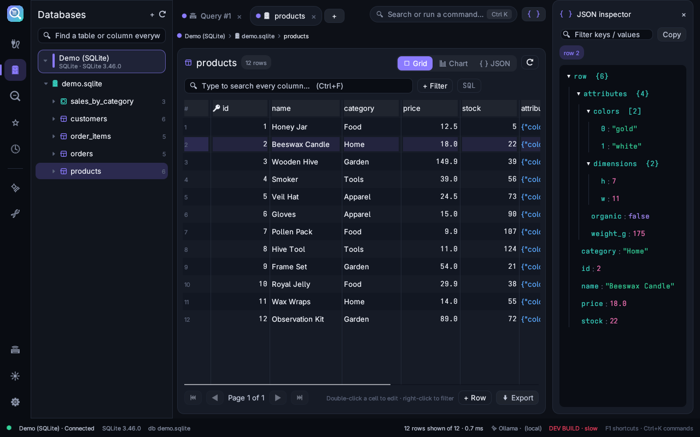

<p align="center"></p>

# BaseLens

**See into every database.** A free, private desktop editor for SQLite, PostgreSQL and MySQL, written in Rust with [egui](https://github.com/emilk/egui).



## Features

- **One navigator for every database**: several connections (and several instances of the same one) side by side, switch databases without reconnecting.
- **Filters without SQL**: click a column, pick a condition, search all text columns at once.
- **Smart editor**: context-aware autocomplete (tables after `FROM`, columns after `alias.`), real values suggested inside `WHERE`, words learned from your queries, `select` and `SELECT` treated the same, formatter that keeps your case, command palette (`Ctrl+K`) and many shortcuts (`F1`).
- **Lens**: ask "is there an email column?" or "where is 'Maria'?" and it tells you which table has it.
- **JSON viewer**, charts and an ER diagram.
- **AI assistant**, local (Ollama) or cloud, or Claude Code from its native install path; read-only queries can run without asking.
- **Private**: passwords encrypted on your computer (system keyring when available), optional PIN lock on idle, read-only connections.
- **Dark and light themes**.
- **Fast on remote servers**: queries never wait behind schema loading (a second connection reads all columns in one query), results arrive in batches and stop at the limit.
- **Debug mode**: `baselens --debug` (or `BASELENS_DEBUG=1`) shows each query's timeline in a panel (`F12`) and in `~/.local/share/baselens/debug.log`; `baselens --bench "<sql>" [--conn <name>]` times a query 10 times.

## Download

Release packages are built by [the release workflow](.github/workflows/release.yml):

| System | Package |
| --- | --- |
| Debian, Ubuntu, Mint | `baselens_<version>_amd64.deb` |
| Fedora, openSUSE, RHEL | `baselens-<version>.x86_64.rpm` |
| Any Linux | `BaseLens-<version>-x86_64.AppImage`, `baselens-<version>-linux-x86_64.tar.gz` |
| Flatpak | `BaseLens-<version>-x86_64.flatpak` (`flatpak install --user BaseLens-*.flatpak`) |
| Arch, Manjaro, CachyOS | `baselens-<version>-1-x86_64.pkg.tar.zst` (`sudo pacman -U …`), or `makepkg -si` in `packaging/arch` |
| Windows 10/11 | `BaseLens-<version>-windows-x64-setup.exe` (installer: Start menu and desktop shortcuts, uninstall from Apps, no admin needed) or `BaseLens-<version>-windows-x64.zip` (portable) |
| macOS 11+ (Apple Silicon and Intel) | `BaseLens-<version>-macos-universal.dmg` |

The macOS app is not notarised: the first time, right-click it and choose **Open**.

## Build from source

```sh
cargo run --release
```

Linux needs `pkg-config` and the OpenSSL headers (`libssl-dev` / `openssl-devel`).

### Packages

| Command | Makes | Where it runs |
| --- | --- | --- |
| `scripts/build-all.sh` | everything below that this computer can make | Linux with Docker |
| `scripts/package-linux.sh` | `.deb`, `.rpm`, AppImage, `.tar.gz` | inside `packaging/docker` (Debian 12, so it runs on older distros) |
| `scripts/package-windows.sh` | Windows installer `-setup.exe` (NSIS) and portable `.zip` (cross-compiled) | inside `packaging/docker` |
| `scripts/package-flatpak.sh` | `.flatpak` bundle | Linux with `flatpak` and `org.freedesktop.Platform//25.08` |
| `scripts/package-arch.sh` | `.pkg.tar.zst` | Arch-based Linux |
| `scripts/package-macos.sh` | universal `.app` in `.dmg` and `.zip` | macOS |

Everything lands in `dist/`.

### Command-line options

| Option | What it does |
| --- | --- |
| `--debug` | debug mode (timings panel on `F12`, `debug.log`) |
| `--bench "<sql>" [--conn <name>]` | runs a query 10 times on a saved connection and prints min / avg / max of each step |
| `--screenshot <file.png>` | opens with demo data, saves a picture of the window and quits |
| `--self-test` | test robot: clicks and types through the app and reports problems |
| `--install-desktop-entry` / `--remove-desktop-entry` | adds or removes the menu entry and icon for a copy not installed by a package (the AppImage does it by itself on first start) |
| `--export-brand <folder>` | writes the logo (SVG, PNGs, .ico) and the .desktop file |

## Tests

```sh
cargo test                       # unit tests
cargo run -- --self-test         # UI test robot
BASELENS_PG_TEST=postgresql://user:pw@localhost/db cargo test live_pg -- --ignored
```

## How it works

[MECHANICS.md](MECHANICS.md) lists the values and rules the app uses and where each one comes from; [mechanics.json](mechanics.json) has the same values in machine-readable form.

## License

[MIT](LICENSE)
